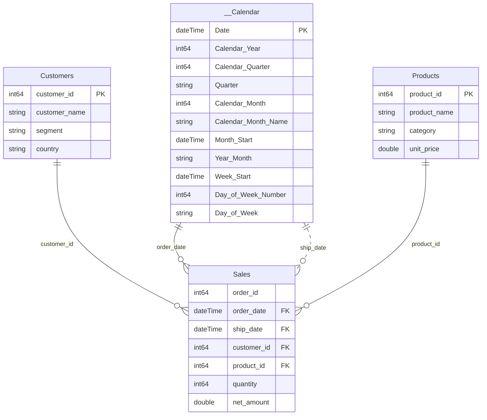

# Model: model spec

Generated by pbip-model-forge 0.1.0 from the model's spec dict. Regenerate it rather than editing it by hand.

## Diagram

## Tables

| Table | Role | Description |
|---|---|---|
| __Calendar | calendar | Calculated date dimension. |
| Customers | dimension | One row per customer. |
| Key Measures | measures | Measure home table: all user-facing measures live here. |
| Products | dimension | Product catalog. |
| Sales | fact | One row per order line. Core fact table. |

### __Calendar

Calculated date dimension.

Range: 2024-01-01 to 2025-12-31.

| Column | Type | Key | Hidden | Format | Description |
|---|---|---|---|---|---|
| Date | dateTime | PK |  | Long Date | One row per calendar day; the key every fact date joins to. |
| Calendar Year | int64 |  |  | 0 | Four-digit calendar year, e.g. 2024. |
| Calendar Quarter | int64 |  | yes | 0 | Quarter number 1-4; sort key for Quarter. |
| Quarter | string |  |  |  | Quarter label, Q1 to Q4. |
| Calendar Month | int64 |  | yes | 0 | Month number 1-12; sort key for Calendar Month Name. |
| Calendar Month Name | string |  |  |  | Full month name, e.g. January. |
| Month Start | dateTime |  |  | mmm yyyy | First day of the month; use it for monthly trend axes. |
| Year-Month | string |  |  |  | Year and month as text, e.g. 2024-01; sorted by Month Start. |
| Week Start | dateTime |  |  | yyyy-mm-dd | Monday of the week the date falls in. |
| Day of Week Number | int64 |  | yes | 0 | Day of week 1-7, Monday = 1; sort key for Day of Week. |
| Day of Week | string |  |  |  | Day name, e.g. Monday; sorted Monday to Sunday. |

### Customers

One row per customer.

| Column | Type | Key | Hidden | Format | Description |
|---|---|---|---|---|---|
| customer_id | int64 | PK | yes |  |  |
| customer_name | string |  |  |  | Customer's trading name. |
| segment | string |  |  |  | Customer size segment: Enterprise, Mid-Market or SMB. |
| country | string |  |  |  | Country of the customer's billing address. |

### Products

Product catalog.

| Column | Type | Key | Hidden | Format | Description |
|---|---|---|---|---|---|
| product_id | int64 | PK | yes |  |  |
| product_name | string |  |  |  | Product or plan name. |
| category | string |  |  |  | Product category: Subscriptions or Services. |
| unit_price | double |  |  | $ #,0.00 | List price per unit, in USD. |

### Sales

One row per order line. Core fact table.

| Column | Type | Key | Hidden | Format | Description |
|---|---|---|---|---|---|
| order_id | int64 |  | yes |  |  |
| order_date | dateTime | FK | yes | General Date |  |
| ship_date | dateTime | FK | yes | General Date |  |
| customer_id | int64 | FK | yes |  |  |
| product_id | int64 | FK | yes |  |  |
| quantity | int64 |  | yes |  |  |
| net_amount | double |  | yes |  |  |

## Relationships

| From (many) | To (one) | Active | Filter |
|---|---|---|---|
| Sales.customer_id | Customers.customer_id | yes | single |
| Sales.order_date | __Calendar.Date | yes | single |
| Sales.product_id | Products.product_id | yes | single |
| Sales.ship_date | __Calendar.Date | no | single |

## Measures

| Measure | Folder | Format | Description | DAX |
|---|---|---|---|---|
| Avg Order Value | Ratios | $ #,0.00 | Average net revenue per order. | `DIVIDE([Total Revenue], [Orders #])` |
| Orders # | Counts | #,0 | Number of distinct orders. | `DISTINCTCOUNT(Sales[order_id])` |
| Total Revenue | Base | $ #,0.00 | Total net revenue across order lines. | `SUM(Sales[net_amount])` |
| Total Units | Base | #,0 | Total units sold across order lines. | `SUM(Sales[quantity])` |
